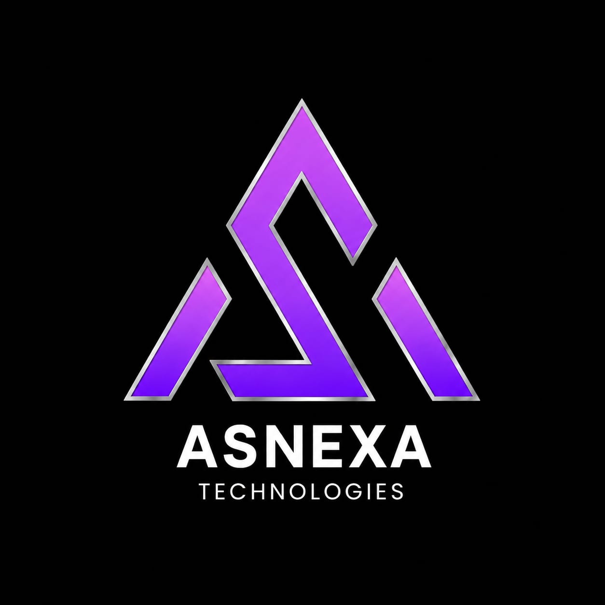

# AsNexa Technologies | Autonomous AI Systems & Digital FTEs



[](https://react.dev/)
[](https://www.typescriptlang.org/)
[](https://vitejs.dev/)
[](https://tailwindcss.com/)
[](https://threejs.org/)
[](https://vercel.com/)

---

## 🌟 Overview

**AsNexa Technologies** is a premier Forward Deployed AI Engineering consultancy and autonomous systems firm. We design, build, and deploy production-grade autonomous **Digital FTEs**, ultra-low latency voice telephony agents, and zero-hallucination governed RAG knowledge engines for growing enterprises.

---

## 🚀 Key Features

- **🤖 Autonomous Digital FTEs:** Multi-agent autonomous workers running continuous business processes across CRM, ERP, and Slack with human-in-the-loop governance.
- **🎙️ Sub-300ms Conversational Voice AI:** Ultra-low latency voice agents capable of qualifying inbound leads, scheduling appointments, and handling tier-1 customer inquiries with zero awkward pauses.
- **🛡️ Governed Enterprise RAG:** Deterministic knowledge engines backed by a strict System of Record (KSoR) verification rubric and hybrid dense vector search to eliminate hallucinations (0.00% hallucination SLA).
- **📈 Interactive Financial ROI Calculator:** Real-time financial modeling tool calculating liberated team hours, net annual savings, and payback timelines.
- **🌐 3D Interactive System Topology:** WebGL Three.js interactive visualizer showcasing system architecture, voice audio wave matrix, and cybernetic node lattice.
- **🌓 Dynamic Light & Dark Mode:** High-contrast, theme-switchable UI with automatic pure-white headings in dark mode and crisp slate typography in light mode.
- **💬 Direct WhatsApp & AI Concierge:** Integrated WhatsApp communication channel alongside an interactive AI concierge assistant.
- **⚡ Vercel & Production Ready:** Configured with `vercel.json` SPA rewrites for instant one-click deployment without 404 routing errors.

---

## 🛠️ Tech Stack

| Technology | Purpose |
| :--- | :--- |
| **React 19** | Modern reactive component architecture |
| **TypeScript** | Type-safe enterprise code |
| **Vite** | Next-generation frontend build tooling |
| **Tailwind CSS v4** | Modern utility-first responsive styling |
| **Three.js** | 3D interactive WebGL canvas and models |
| **React Router v7** | Client-side routing and deep-linking |
| **Lucide React** | Clean, accessible iconography |
| **Canvas Confetti** | Delightful interaction feedback animations |

---

## 📁 Project Structure

```text
asnexa-technologies/
├── public/                 # Static assets, logos, and favicon
│   └── assets/aistudio/    # Branding logos and imagery
├── src/
│   ├── components/         # Modular UI components
│   │   ├── Navbar.tsx             # Responsive header with theme toggle & quick route bar
│   │   ├── Footer.tsx             # Enterprise footer with route links
│   │   ├── HomeSection.tsx        # Hero, workforce synergy, pillars & ROI banner
│   │   ├── ServicesSection.tsx    # 6 core service architectures & modals
│   │   ├── IndustriesSection.tsx  # Industry workflows & deep dives
│   │   ├── CalculatorSection.tsx  # Interactive financial ROI model
│   │   ├── SandboxSection.tsx     # Voice agent, RAG & workflow simulator
│   │   ├── ThreeDHeroCanvas.tsx   # 3D interactive hero animation
│   │   ├── ThreeDModelShowcase.tsx# 3D animated architectural topology
│   │   ├── ThreeDVoiceVisualizer.tsx # WebGL audio waveform visualizer
│   │   ├── ConciergeChatbot.tsx   # Interactive AI concierge assistant
│   │   └── WhatsAppButton.tsx     # Direct WhatsApp connect button
│   ├── context/
│   │   └── ThemeContext.tsx       # Light/Dark mode state with localStorage persistence
│   ├── data/
│   │   └── servicesData.ts        # Comprehensive service architectural specs
│   ├── pages/                     # Routed view pages (Home, Services, Calculator, etc.)
│   ├── App.tsx                    # Root routing and application wrapper
│   ├── main.tsx                   # React DOM entry point
│   └── index.css                  # Tailwind styles & dark mode heading rules
├── vercel.json             # Vercel deployment & SPA rewrite routing
├── vite.config.ts          # Vite build configuration
├── package.json            # Dependencies and scripts
└── tsconfig.json           # TypeScript configuration
```

---

## 💻 Local Development Setup

### 1. Clone the repository:
```bash
git clone https://github.com/your-username/asnexa-technologies.git
cd asnexa-technologies
```

### 2. Install dependencies:
```bash
npm install
```

### 3. Start development server:
```bash
npm run dev
```
Open your browser at `http://localhost:3000`.

### 4. Build for production:
```bash
npm run build
```

### 5. Type-check & lint:
```bash
npm run lint
```

---

## 🚀 Deploying to Vercel

This repository is pre-configured with `vercel.json` for one-click deployment:

1. Push your code to your GitHub repository:
   ```bash
   git add .
   git commit -m "feat: complete AsNexa autonomous AI platform"
   git push origin main
   ```

2. Log in to [Vercel](https://vercel.com) and click **"Add New" > "Project"**.
3. Select your GitHub repository and click **"Import"**.
4. Vercel will automatically detect **Vite**:
   - **Framework Preset:** `Vite`
   - **Build Command:** `npm run build`
   - **Output Directory:** `dist`
5. Click **"Deploy"**. Your site will be live worldwide in seconds!

---

## 📄 License & Copyright

© 2026 AsNexa Technologies Inc. All rights reserved.
Autonomous AI Systems, Digital FTEs & Forward Deployed Engineering.
